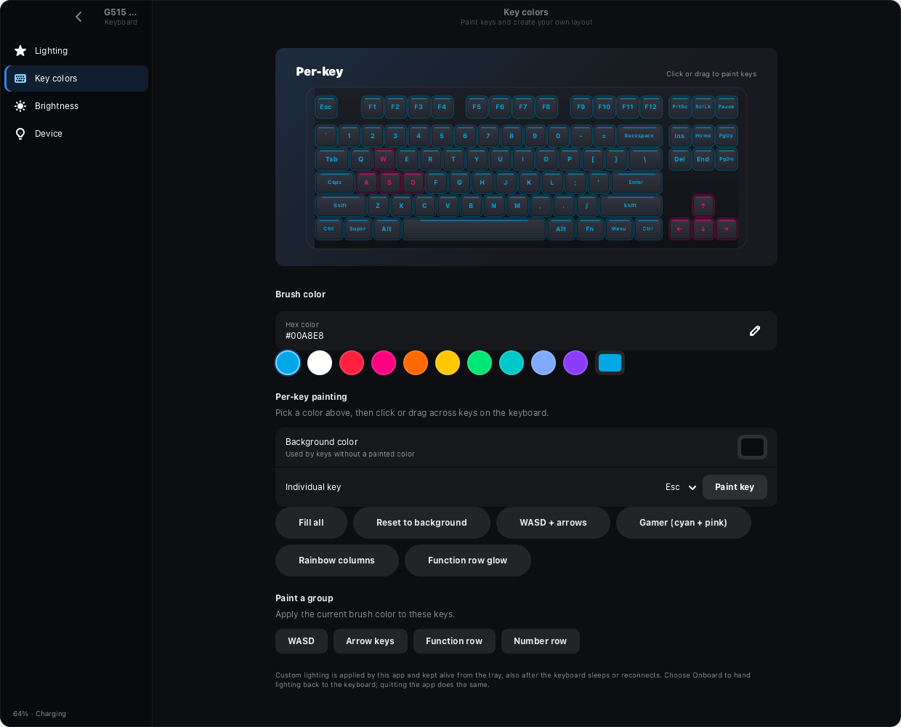
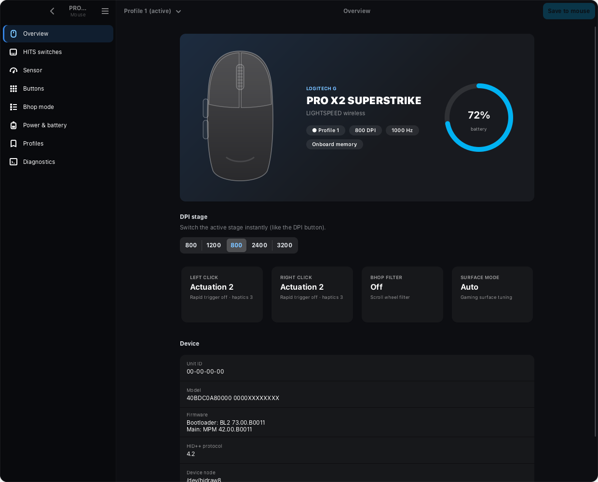

<div align="center">


# G HUB Linux Ported

A Linux app for configuring Logitech mice and keyboards.


</div>

Adjust mouse settings, customize keyboard lighting and check battery levels.
GLP runs locally, with no account or internet connection required. The interface
uses GTK4 and libadwaita.

## Controls

- Mouse sensitivity, polling rate, button assignments and onboard profiles.
- Keyboard lighting effects, brightness and individual key colors.
- Color presets, hex color entry and painting for groups of keys.
- Battery information, notifications and quick controls from the system tray.

Available controls depend on the device. Some devices can be detected but do
not yet have configuration support. See the [support notes](docs/DEVICE-SUPPORT-RESEARCH.md)
for current coverage and work on additional devices.

## Screenshots

Mouse and keyboard settings use the same sidebar navigation.




<details>
<summary>Mouse settings</summary>



</details>

Screenshots show the app with simulated devices and battery levels.
[Run the preview locally](docs/screenshots/README.md).

## Install

On Arch Linux:

```sh
sudo pacman -S python-gobject gtk4 libadwaita libdbusmenu-glib
git clone https://github.com/Bettencourtzw/ghub-linuxported.git
cd ghub-linuxported
./install.sh --udev
```

Open **G HUB Linux Ported** from your app menu. To start it in the tray at login:

```sh
systemctl --user enable --now ghub-linuxported-tray.service
```

Closing the window keeps the app in the tray. Choose **Quit** from the tray menu
to exit.

## Saving settings

Mouse profiles can be saved to onboard memory where supported. GLP backs up
the previous settings before writing and checks the result afterward.

Custom keyboard lighting is saved locally and restored when the keyboard
reconnects. Keep GLP running to maintain it. Choosing **Onboard**, or quitting
the app, returns lighting control to the keyboard.

## Development

```sh
python3 -m unittest discover -s tests
python3 tools/ui_preview.py --interactive
```

The preview uses temporary settings and does not access hardware.
[Preview setup and screenshot commands](docs/screenshots/README.md).

[Protocol documentation](docs/PROTOCOL.md) ·
[Device support research](docs/DEVICE-SUPPORT-RESEARCH.md) ·
[Artwork sources](packaging/devices/SOURCES.md)

## Credits and license

GLP uses protocol research from the Linux device community. Sources and
acknowledgments are listed in the [protocol documentation](docs/PROTOCOL.md)
and [support notes](docs/DEVICE-SUPPORT-RESEARCH.md).

The code is [MIT licensed](LICENSE). Product artwork has separate rights, listed
in the [artwork sources](packaging/devices/SOURCES.md).
GLP is an independent project and is not affiliated with Logitech.
