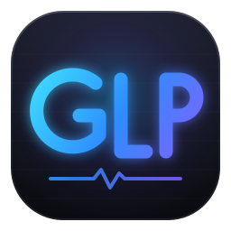
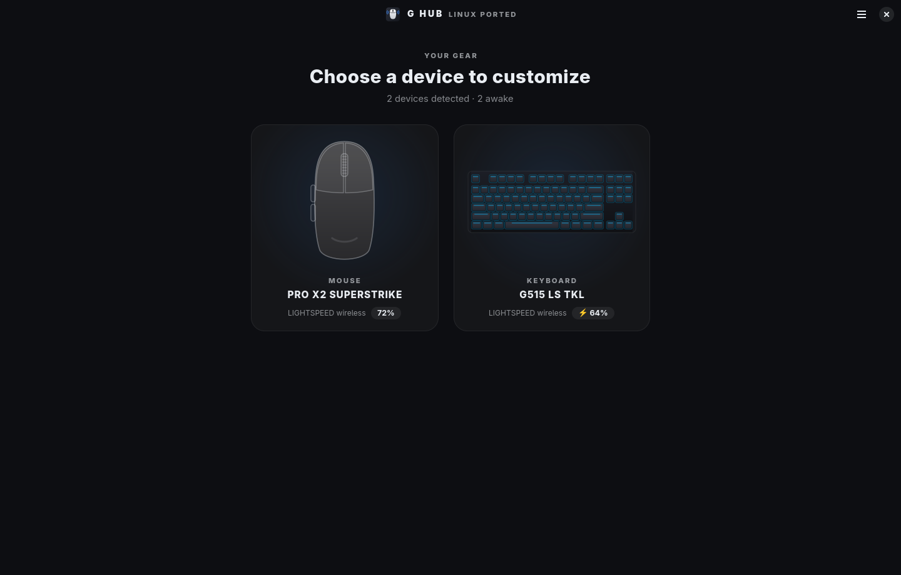
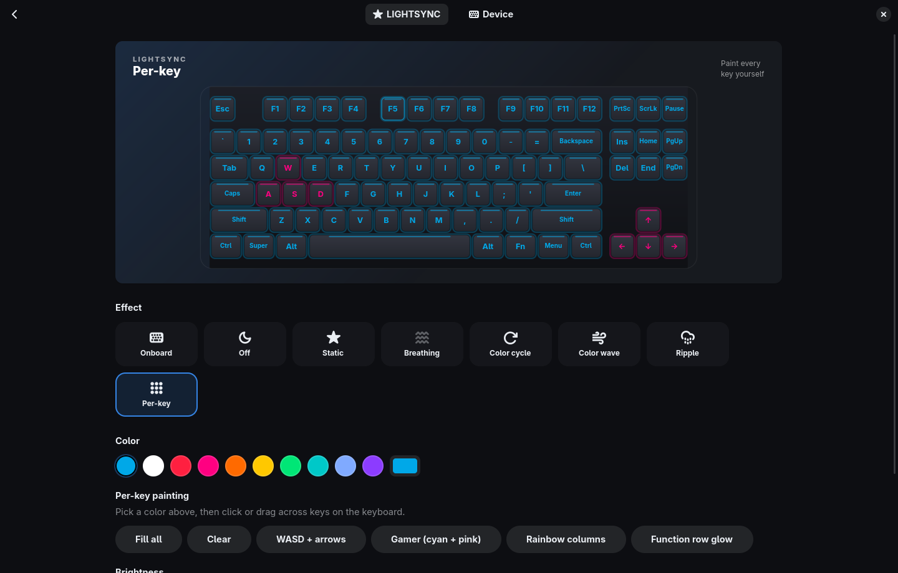
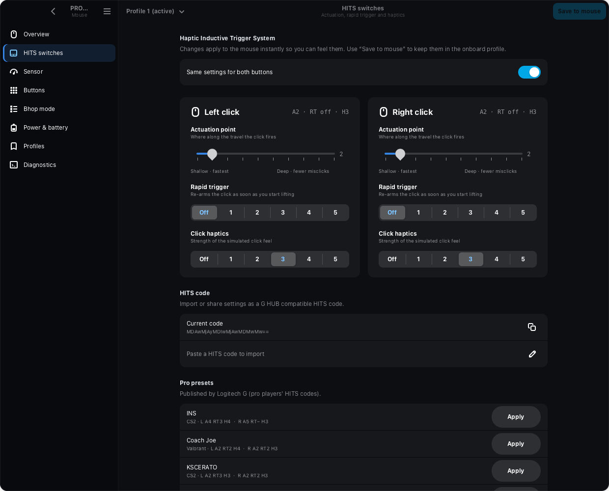

<div align="center">



# G HUB Linux Ported

**Your Logitech gear. One Linux control panel.**<br>
Discover your devices, check their status and customize supported features.<br>
Native GTK4. Local and offline. Community-built.




</div>

## One place for your setup

G HUB Linux Ported (GLP) brings Logitech HID++ devices into a shared desktop
interface. Open the device overview, choose your mouse or keyboard, and find
the controls available for that device.

- **Device overview** — see detected devices and available battery information.
- **Mouse controls** — adjust sensitivity, polling, buttons and onboard profiles on supported models.
- **Keyboard lighting** — choose effects, set brightness and paint individual keys on supported keyboards.
- **Tray companion** — keep mouse battery, alerts and quick DPI controls close at hand.
- **Local settings** — apply changes directly, without a cloud account.

## Compatibility

Features depend on the model and the HID++ capabilities it exposes. Discovery
of a device does not mean that all of its settings can be changed. GLP is an
independent project, not an official Linux edition of Logitech G HUB.

See the [device support research](docs/DEVICE-SUPPORT-RESEARCH.md) for candidate
models, protocol differences and the hardware checks needed to add support.

| Device | Current support |
|---|---|
| **PRO X2 SUPERSTRIKE** | HITS actuation, rapid trigger and haptics · DPI stages · polling up to 8 kHz · button remapping · bhop mode · onboard profiles |
| **G515 LS TKL** | LIGHTSYNC effects (static, breathing, color cycle, wave, ripple) · per-key painting · brightness |
| **Other Logitech HID++ devices** | Device information, with battery and firmware details where available; configuration support varies |

<p align="center">
  
  
</p>

## Everyday use

Changes apply as you make them, with an animated preview for keyboard lighting.
Closing the window keeps the tray helper running; right-click its icon and
choose **Quit** to exit.

On supported mice, saving to onboard memory creates a backup, checks the CRC
and verifies the written data byte for byte. Keyboard lighting is re-applied
after sleep or reconnect, and control returns to the keyboard when you quit.

## Install

```sh
# Arch: sudo pacman -S python-gobject gtk4 libadwaita libdbusmenu-glib
git clone https://github.com/Bettencourtzw/ghub-linuxported.git
cd ghub-linuxported
./install.sh --udev
```

Open **G HUB Linux Ported** from your app menu. To start it hidden in the tray at login:

```sh
systemctl --user enable --now ghub-linuxported-tray.service
```

## Command line

The CLI currently focuses on the PRO X2 SUPERSTRIKE mouse:

```sh
ghub-linuxported-cli status                                # mouse battery, DPI, HITS, bhop
ghub-linuxported-cli hits --code MDAwNDA1MDMwNTEwMDQwMw==  # apply a HITS code
ghub-linuxported-cli rate                                  # measure real polling rate
```

## Credits

Built on the community's reverse-engineering work:
[xatuke](https://github.com/xatuke/logitech-superstrike-pro-x2-controller),
[kazehana99k](https://github.com/kazehana99k/Logitech-PRO-X2-SUPERSTRIKE-Linux-haptics-actuation-control-),
[linux-superstrike](https://github.com/mclol0/linux-superstrike),
[Solaar](https://github.com/pwr-Solaar/Solaar),
[OpenRGB](https://gitlab.com/CalcProgrammer1/OpenRGB) and
[libratbag](https://github.com/libratbag/libratbag).
Protocol notes: [docs/PROTOCOL.md](docs/PROTOCOL.md).
Product artwork: [sources and separate rights notice](packaging/devices/SOURCES.md).

<sub>Not affiliated with Logitech. "Logitech", "G HUB", "LIGHTSYNC", "PRO X2 SUPERSTRIKE" and "G515" are trademarks of Logitech. MIT licensed.</sub>
