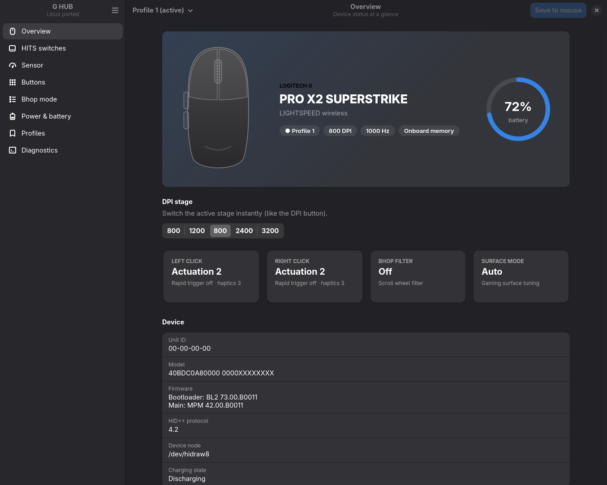
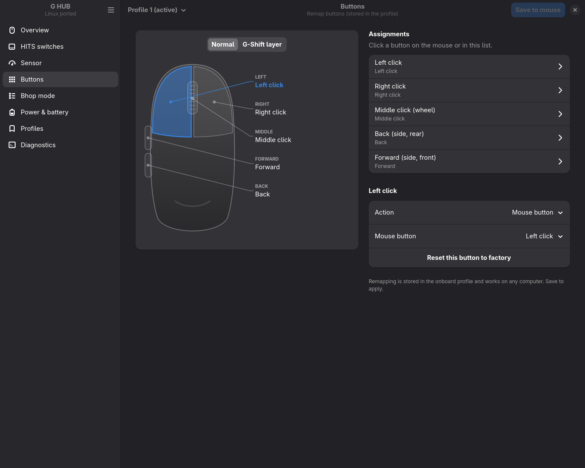

<div align="center">


# G HUB Linux Ported

**Native Linux control panel for the Logitech G PRO X2 SUPERSTRIKE.**<br>
HITS switches, DPI, polling rate, buttons, bhop mode, profiles. Local and offline.




</div>

## Features

- **HITS switches**: actuation point, rapid trigger and click haptics per button, applied live
- **HITS codes**: import and export G HUB codes, one-click pro presets
- **Sensor**: 5 DPI stages up to 44 000 (X/Y), lift-off distance, up to 8 kHz polling, surface mode
- **Buttons**: remap to clicks, key combos, media keys or DPI/profile functions, plus a G-Shift layer
- **Bhop mode**: scroll-wheel filter with an adjustable 100–1000 ms window
- **Profiles**: 5 onboard profiles, JSON import/export, automatic backups before every write
- **Tray**: battery in your bar, low-battery alerts, quick DPI and profile switching
- **Diagnostics**: real measured polling rate, click tester, raw HID++ console

Settings are saved to the mouse's onboard memory, so they keep working on any PC.

<p align="center">
  
  
</p>

## Install

```sh
# Arch: sudo pacman -S python-gobject gtk4 libadwaita
git clone https://github.com/Bettencourtzw/ghub-linuxported.git
cd ghub-linuxported
./install.sh --udev
```

`--udev` installs a rule (needs sudo) that lets your user talk to the mouse.
Then open **G HUB Linux Ported** from your app menu.

Optional tray helper:

```sh
systemctl --user enable --now ghub-linuxported-tray.service
# or in hyprland.conf:  exec-once = ghub-linuxported-tray
```

## CLI

```sh
ghub-linuxported-cli status                              # battery, DPI, rate, HITS, bhop
ghub-linuxported-cli hits --code MDAwNDA1MDMwNTEwMDQwMw==  # apply a HITS code
ghub-linuxported-cli rate                                # measure real polling rate
ghub-linuxported-cli dump                                # read-only dump of onboard memory
```

## Safety

Every write to the mouse is backed up first, checked with a CRC and verified
byte-for-byte. Backups live in `~/.local/share/ghub-linuxported/backups` and
can be restored from the Profiles page.

## Credits

Built on the community's reverse-engineering work:
[xatuke](https://github.com/xatuke/logitech-superstrike-pro-x2-controller),
[kazehana99k](https://github.com/kazehana99k/Logitech-PRO-X2-SUPERSTRIKE-Linux-haptics-actuation-control-),
[linux-superstrike](https://github.com/mclol0/linux-superstrike),
[Solaar](https://github.com/pwr-Solaar/Solaar) and
[libratbag](https://github.com/libratbag/libratbag).
Protocol notes: [docs/PROTOCOL.md](docs/PROTOCOL.md).

<sub>Not affiliated with Logitech. "Logitech", "G HUB" and "PRO X2 SUPERSTRIKE" are trademarks of Logitech. MIT licensed.</sub>
